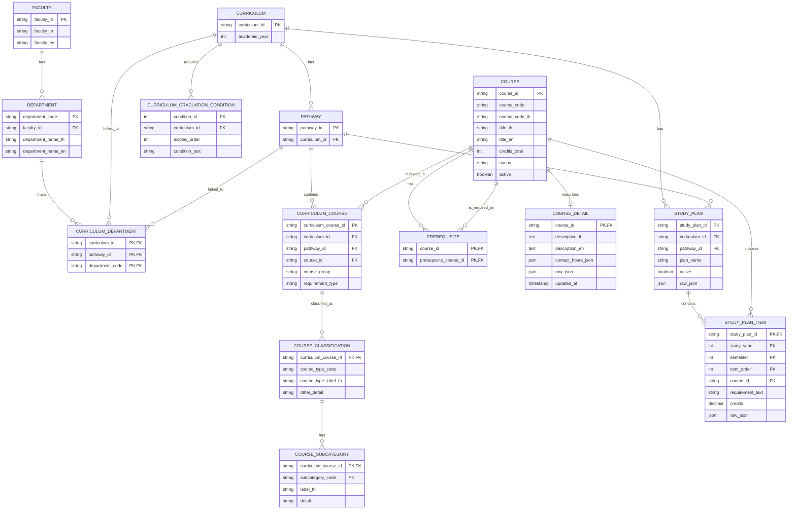
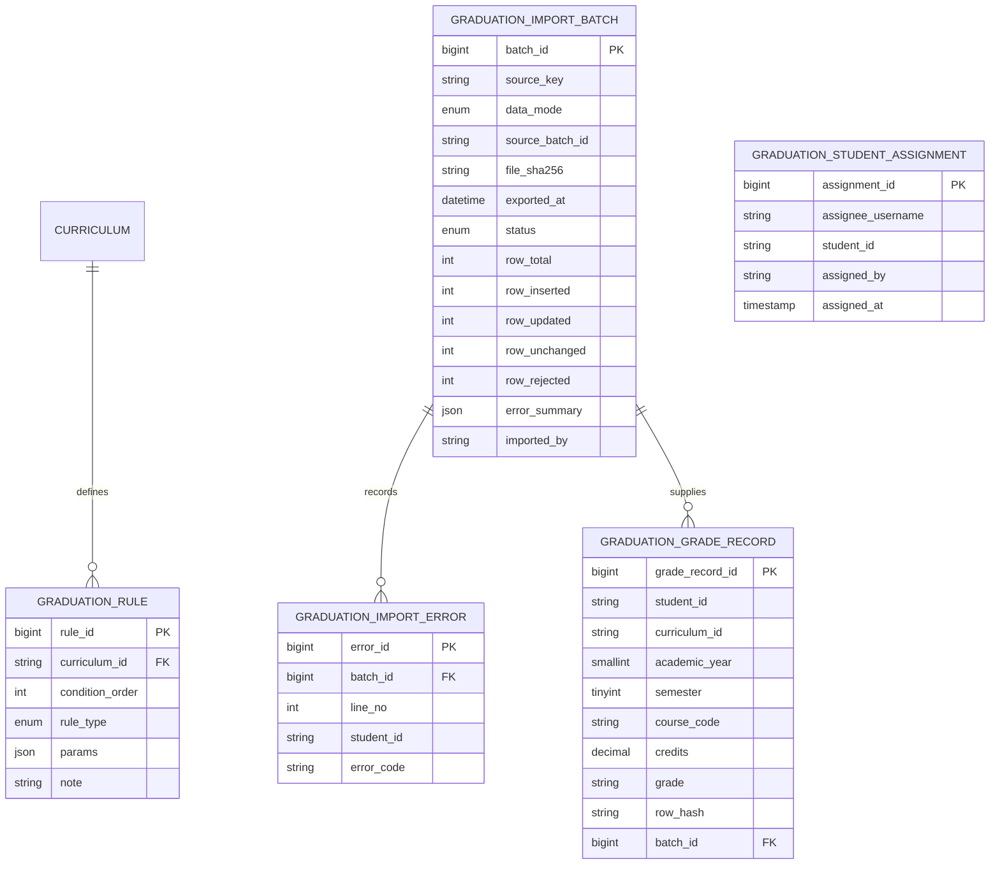
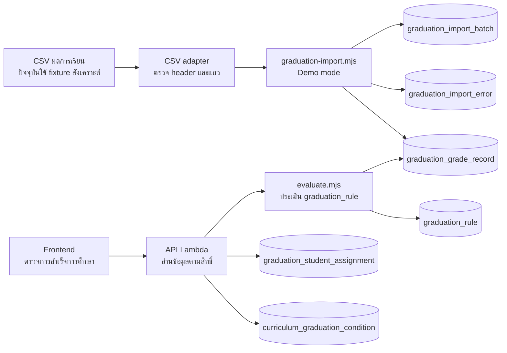

# [Architecture] Data Model / ERD สำหรับ V2

> เอกสารนี้เริ่มจาก ERD ของ V2 และมีภาคผนวก V4 ด้านล่างเพื่อให้เห็นตารางตรวจสอบการสำเร็จการศึกษาและ data flow ที่เพิ่มเข้ามา

## Goal

ออกแบบ Data Model สำหรับข้อมูลหลักสูตร รายวิชา และวิชาบังคับก่อน เพื่อรองรับข้อมูลหลายปีหลักสูตร การค้นหา และการกรองข้อมูลใน V2

## Entities

## Design notes

- `FACULTY` และ `DEPARTMENT` รับข้อมูลจาก Faculty API และ Department API
- `CURRICULUM`, `PATHWAY`, `COURSE` และ `CURRICULUM_COURSE` รับข้อมูลจาก Course Catalog API
- `COURSE` แยกจาก `CURRICULUM_COURSE` เพราะวิชาเดียวกันสามารถอยู่ได้หลาย pathway
- `CURRICULUM_DEPARTMENT` ใช้เชื่อมข้อมูลสาขาจาก University API กับหลักสูตรจาก Course Catalog API
- ID จาก API ใช้ชนิดข้อมูล `string` เพราะเป็นรหัส เช่น `BSC-CS-2566-CIS-CS100`
- `CURRICULUM_COURSE` เป็นตารางเชื่อมระหว่าง pathway กับรายวิชา
- `COURSE_CLASSIFICATION` เก็บประเภทและหมวดหมู่ของรายวิชาตาม curriculum placement
- `PREREQUISITE` รองรับความสัมพันธ์วิชาบังคับก่อนแบบหลายต่อหลาย
- `COURSE_DETAIL` เก็บรายละเอียดเพิ่มเติมของรายวิชาที่มาจาก Course Catalog API
- `STUDY_PLAN` และ `STUDY_PLAN_ITEM` เก็บแผนการเรียนแยกตาม pathway ปีการศึกษา และภาคการศึกษา
- `CURRICULUM_GRADUATION_CONDITION` เก็บเงื่อนไขสำเร็จการศึกษาที่ Frontend ใช้แสดง
- ข้อมูลจากทั้งสาม API ควรถูกแปลงเข้าสู่ Model นี้ก่อนส่งให้ Frontend

## Acceptance criteria

- มี ERD ที่ทีมเห็นชอบ
- รองรับหลักสูตรหลายปีการศึกษา
- รองรับการค้นหารายวิชาและกรองตามหลักสูตร/หมวดวิชา
- รองรับการแสดงวิชาบังคับก่อน
- ระบุ Mapping ระหว่างข้อมูลจาก API กับ Entity ในระบบ

## ภาคผนวก V4: ตรวจสอบการสำเร็จการศึกษา (Demo เท่านั้น)

Migration `010_graduation_verification.sql` เพิ่มตาราง 5 ตารางสำหรับรับผลการเรียนแบบ CSV ประเมินเงื่อนไขจบ และจำกัดการตรวจสอบตามผู้ได้รับมอบหมาย ตารางชุดนี้ยังไม่ใช่การเชื่อมต่อทะเบียนจริง และ fixture ที่ใช้ทดสอบเป็นข้อมูลสังเคราะห์เท่านั้น

### ERD ของตาราง V4

เส้นทึบด้านล่างแสดง foreign key ที่ migration สร้างจริง ส่วนความสัมพันธ์กับ `student_id`, `assignee_username` และ `curriculum_id` ในบางตารางเป็นการอ้างอิงเชิงข้อมูลเท่านั้น เพราะ migration นี้ยังไม่ได้สร้าง foreign key ไปยังตารางผู้ใช้หรือตารางหลักสูตรสำหรับคอลัมน์เหล่านั้น

`GRADUATION_STUDENT_ASSIGNMENT` จำกัดว่าอาจารย์หรือเจ้าหน้าที่คนใดดูผลของนักศึกษาคนใดได้ แต่ใน migration นี้ไม่มี FK ไปยังตารางบัญชีผู้ใช้ และไม่มี FK ของ `student_id` ไปยังทะเบียนนักศึกษา `GRADUATION_GRADE_RECORD` ใช้ unique key จากนักศึกษา หลักสูตร ปี ภาคเรียน และรหัสวิชาเพื่อให้การนำเข้าซ้ำอัปเดตแถวเดิม

### Data flow ของ V4

V4 เพิ่ม route ใน Lambda เดิมและ frontend เรียก API สำหรับอ่านผล ส่วน CLI ใช้นำเข้า CSV ใน Demo เท่านั้น ปัจจุบันไม่มีการเชื่อมต่อทะเบียนจริง สถานะ migration บน RDS ที่ deploy อยู่ยังไม่ทราบ จึงห้ามรัน migration หรือ importer กับ RDS จนกว่าจะตรวจสอบสถานะ อนุมัติ data contract และมีแผน deploy แยกต่างหาก
